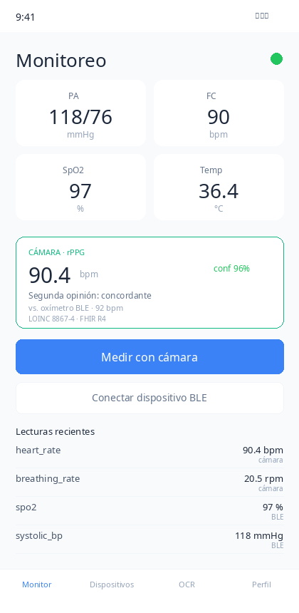

# camera-vitals

[](LICENSE)
[](package.json)

Turn a webcam into a vital-signs source. Measures **pulse, breathing rate and
heart-rate variability** from a camera and emits them as **LOINC-coded
observations**, ready for a remote patient monitoring pipeline.

No wearable. No BLE device. No screen to photograph. The camera is the sensor.

**[Demo video](docs/camera-vitals-demo.mp4)** ·
**[med365x integration](docs/MED365X-INTEGRATION.md)** ·
**[App mockup](docs/mockup-monitor.png)**



```bash
npm install
export PHYSIOLOGY_API_KEY=your-key
npx camera-vitals --seconds 30
```

```json
{"metric":"PULSE_RATE","subject":"anonymous","code":{"system":"http://loinc.org","code":"8867-4","display":"Heart rate"},"valueQuantity":{"value":68.4,"unit":"/min"}}
```

## Verified measurement

Pulse **90.4 bpm** and breathing **20.5 rpm** from a 95-second recording, emitted
as FHIR R4 with confidence attached:

```text
8867-4     90.4 /min   Heart rate
9279-1     20.5 /min   Respiratory rate
```

24 tests, no camera or API key required: `npm test`.

## Why

Remote patient monitoring has a hardware problem. Every vital sign needs
something to measure it: a blood-pressure cuff, a pulse oximeter, a scale, a
BLE wearable. If the device is not charged, not paired, or not there, there is
no data that day.

Almost every patient already has a camera. This adapter makes that camera count.

It is deliberately small: it measures, it maps to clinical vocabulary, and it
hands the result to whatever pipeline you already run. It does not store
anything, does not ship a database, and does not care which EHR you use.

## Install

Requires Node 20 or newer and a working camera.

```bash
git clone <this-repo>
cd camera-vitals
npm install
```

Get a physiology API key from [Presage](https://physiology.presagetech.com)
and export it:

```bash
export PHYSIOLOGY_API_KEY=...
```

Verify the camera and key before measuring:

```bash
npx camera-vitals --seconds 10
```

On Linux, the SDK needs an X display and `libx11`. On a headless server that
means no camera capture — use `--file` with a recorded video instead.

## Usage

### Measure from the camera

```bash
npx camera-vitals --seconds 30 --subject patient-42
```

### Write JSONL

```bash
npx camera-vitals --seconds 60 --subject patient-42 --out vitals.jsonl
```

### Emit FHIR R4 Observations

```bash
npx camera-vitals --seconds 30 --subject patient-42 --fhir
```

```json
{
  "resourceType": "Observation",
  "id": "patient-42-PULSE_RATE-2026-11-22T12-00-00",
  "status": "final",
  "category": [{ "coding": [{ "system": "http://terminology.hl7.org/CodeSystem/observation-category", "code": "vital-signs" }] }],
  "code": { "system": "http://loinc.org", "code": "8867-4", "display": "Heart rate" },
  "subject": { "reference": "Patient/patient-42" },
  "effectiveDateTime": "2026-11-22T12:00:00.000Z",
  "valueQuantity": { "value": 68.4, "unit": "/min", "system": "http://unitsofmeasure.org", "code": "/min" }
}
```

### Publish to NATS

```bash
npm install nats
npx camera-vitals --seconds 30 --subject patient-42 \
  --nats nats://localhost:4222 --tenant acme
```

Publishes to `med365x.acme.vitals.camera`, beside the BLE and HealthKit
channels, so an existing pipeline needs no change to consume it.

### Analyse a recorded video

```bash
npx camera-vitals --file ./consultation.mp4 --seconds 120 --subject patient-42
```

### As a library

```js
import { capture, toObservations, toFhir, natsSubject } from "@ccvass/camera-vitals";

await capture({
  apiKey: process.env.PHYSIOLOGY_API_KEY,
  seconds: 30,
  onObservations: (payload) => {
    const observations = toObservations(payload, { subject: "patient-42" });
    for (const obs of observations) {
      console.log(toFhir(obs));
    }
  },
});
```

## Capture service

For an app to consume the camera, the capture runs where the camera is and
exposes a small HTTP surface.

```bash
npm run serve            # http://localhost:8099
```

| Method | Path | Purpose |
|---|---|---|
| `POST` | `/capture` | start a session: `{ seconds, subject }` → `202 { id }` |
| `GET` | `/capture/:id` | `{ state, observations, guidance, error }` |
| `GET` | `/vitals/latest` | newest reading, as FHIR Observations |
| `POST` | `/second-opinion` | compare against another channel |
| `GET` | `/health` | `{ status, busy, hasLatest }` |

```bash
curl -X POST localhost:8099/capture \
  -H 'content-type: application/json' \
  -d '{"seconds":30,"subject":"patient-42"}'
```

Two operational facts the code accounts for, both learned the hard way:

- **The SDK spends about twenty seconds warming up** before the first frame is
  validated. A 10-second capture takes roughly 30 seconds end to end, so the
  service's deadline is the requested time plus a minute of slack.
- **Capture runs in a child process.** A stuck session would otherwise hold the
  camera until the API died. Isolating it means a hung capture is killed on
  deadline and an API restart never leaves the device locked.

On a headless host the SDK still needs X11: set `DISPLAY`, or use `--file`
against a recorded video. Without a display the camera opens and then stalls
rather than failing, which looks like a hang.

### Second opinion

A camera reading is worth more when it can confirm or contradict something the
patient already reported. A pulse oximeter says 72; the camera says 74; the
reading is corroborated. The same pair at 72 and 96 is not a disagreement to
average away, it is a reason to look.

```bash
curl -X POST localhost:8099/second-opinion \
  -H 'content-type: application/json' \
  -d '{"reference":[{"metric":"PULSE_RATE","valueQuantity":{"value":74},"device":"ble-oximeter"}]}'
```

```json
{
  "verdict": "concordant",
  "comparisons": [
    { "metric": "PULSE_RATE", "candidate": 72, "reference": 74, "delta": -2, "tolerance": 5, "verdict": "concordant" }
  ],
  "summary": "Camera reading agrees with the reference channel."
}
```

Verdicts are `concordant`, `discordant` or `insufficient`. Tolerances default to
the larger of an absolute or relative margin per metric (`src/reconcile.mjs`)
and can be overridden per request.

**These tolerances are heuristics chosen for this adapter, not validated
clinical limits.** A deployment must set its own after comparing against its
reference device. A `discordant` verdict means "review before acting", never
"the camera is right".

## med365x integration

Two different things travel to the platform, and keeping them apart matters:

- **The vitals** go over NATS as FHIR Observations, beside the BLE and HealthKit
  channels, on `med365x.<tenant>.vitals.camera`.
- **The transmission record** goes over REST
  (`POST /api/v1/patients/{id}/rpm-transmissions` with `source: "camera-rppg"`)
  and answers a different question: did the patient transmit today. It is what
  RPM enrolment and billing count.

A broker outage therefore does not erase the day's adherence, and a REST failure
does not lose the measurement.

```js
import { toTransmission, recordTransmission } from "@ccvass/camera-vitals";

const body = toTransmission(observations, { deviceId });
await recordTransmission({ baseUrl, token, tenantId, patientId, body });
```

The endpoint requires an active RPM enrolment and the `X-Tenant-Id` header; it
returns 404 without the enrolment. `recordTransmission` reports the status
instead of throwing, so a failed transmission record never discards a reading.

## LOINC mapping

A number without a code is not interoperable. Every metric is mapped to a
verified LOINC code so it can enter any clinical system unchanged.

| SDK metric | LOINC | Display | Unit |
|---|---|---|---|
| `PULSE_RATE` | [8867-4](https://loinc.org/8867-4) | Heart rate | /min |
| `BREATHING_RATE` | [9279-1](https://loinc.org/9279-1) | Respiratory rate | /min |
| `HRV_SDNN` | [80404-7](https://loinc.org/80404-7) | R-R interval.standard deviation | ms |
| `HRV_RMSSD` | [80406-2](https://loinc.org/80406-2) | R-R interval.RMSSD | ms |

Add a metric by extending `LOINC` and `READERS` in `src/loinc.mjs`. The test
suite asserts every entry has a well-formed code, a display name and a unit.

## Consent and data handling

This matters more than the measurement, so it is written down rather than
assumed.

**Camera access** is explicit. Nothing is captured until the process starts and
`start()` is called. There is no background capture and no idle camera.

**SDK telemetry is off.** SmartSpectra sends aggregate session summaries by
default. This adapter passes `enableTelemetry: false` on every session, so no
usage data leaves the device. If you fork this and remove that flag, disclose
the change.

**Video never leaves the machine.** Frames are processed locally and are not
written to disk, uploaded, or retained. `--file` reads a local video and does
the same.

**Only derived numbers are emitted.** The output is a heart rate, a breathing
rate and HRV statistics — no imagery, no face landmarks, no embeddings, no
identifiers beyond the `--subject` value you supply.

**No storage by default.** Without `--out`, `--nats` or `--http`, observations
go to stdout and are gone when the process exits. With a sink, retention is
whatever that sink does — this adapter sets none and deletes none.

**Subjects are pseudonymous.** `--subject` is yours to choose. Use a study id or
a hashed identifier, not a name. The default is `anonymous`.

**LLM processing is not used.** The SDK offers optional LLM Insights that send
metric windows to a gateway. This adapter does not enable them.

**Not a medical device.** These measurements are for general wellness and
informational purposes. They are not FDA-cleared and must not be used for
diagnosis or treatment. See the Presage model cards for validated ranges and
failure conditions.

## Payload shape

The `metrics` event delivers a **protobuf Buffer**, not an object, and the
decoded shape is not obvious:

- `cardio.pulseRate` is an **array** of `MeasurementWithConfidence`, each with
  `value`, `confidence`, `stable` and `timestamp`.
- `breathing.rate` is the same shape.
- `cardio.hrv` is an array of `Hrv` with `sdnn`, `rmssd`, `meanNn`, `baevsky`.

`src/capture.mjs` registers the generated protobuf class via
`setMetricsClass()` so `decodeMetrics()` returns a readable message. Note that
the generated module is **not in the package's `exports` map**, so it cannot be
required by subpath — it has to be resolved to a file path:

```js
const pkgJson = require.resolve("@smartspectra/node-sdk/package.json");
const generated = require(join(dirname(pkgJson), "js/messages/generated.js"));
setMetricsClass(generated.presage.smartspectra.Metrics);
```

Without that registration the payload stays a byte array, every frame looks
empty, and the mapping silently produces nothing — which reads as a framing
problem when it is not.

Readings are running windows, so the adapter takes the **newest** entry of each
array and carries `confidence` and `stable` through to the observation. A
consumer should ignore unstable or zero-confidence values rather than treat
every number as equal.

## Measurement quality

The SDK is strict about conditions, and it tells you exactly what is wrong.
This adapter surfaces those codes as plain guidance instead of failing silently:

```text
guidance: Face too low — raise your head or tilt the camera down
guidance: Chest not visible — tilt the camera down
```

Typical fixes:

| Message | Fix |
|---|---|
| Face too low / too high | Raise or lower your head; centre the face vertically |
| Chest not visible | Tilt the camera down so shoulders are in frame |
| Too dark | Put light in front of you, not behind |
| Face not forward | Look straight at the lens |
| Excessive motion | Hold still; a phone on a stand beats a hand |

Validated ranges, per the Presage model cards:

| Metric | Window | Valid range |
|---|---|---|
| Pulse rate | 12 s average | 40–110 BPM |
| Breathing rate | 30 s average | 5–40 breaths/min |
| HRV | 60 s window | 40–110 BPM |

HRV confidence stays at zero until the full 60-second window completes. A
30-second run will report pulse and breathing but no HRV — that is expected,
not a bug.

## Architecture

```text
camera ──▶ SmartSpectra SDK ──▶ toObservations ──▶ sink
             (rPPG, on device)      (LOINC)         ├─ stdout
                                                    ├─ JSONL
                                                    ├─ FHIR R4
                                                    └─ NATS

app ──HTTP──▶ server.mjs ──child process──▶ cli.mjs
                  │
                  └─▶ reconcile.mjs ──▶ second opinion
                  └─▶ med365x.mjs ──▶ rpm-transmissions
```

| File | Responsibility |
|---|---|
| `src/capture.mjs` | SDK session, telemetry off, validation translated |
| `src/loinc.mjs` | Metric → LOINC → FHIR mapping, NATS subject |
| `src/emit.mjs` | Sinks, loaded lazily |
| `src/reconcile.mjs` | Second opinion against another channel |
| `src/med365x.mjs` | Transmission payload and REST client |
| `server.mjs` | HTTP capture service, capture isolated in a child process |
| `cli.mjs` | Command-line entry |

## Tests

```bash
npm test
```

Covers the LOINC mapping, FHIR shape and id constraints, tenant sanitisation,
payload-shape tolerance, second-opinion verdicts and the med365x transmission
contract. No camera or API key needed.

## License

MIT. See [LICENSE](LICENSE).

SmartSpectra is a product of Presage Technologies and is licensed separately.
