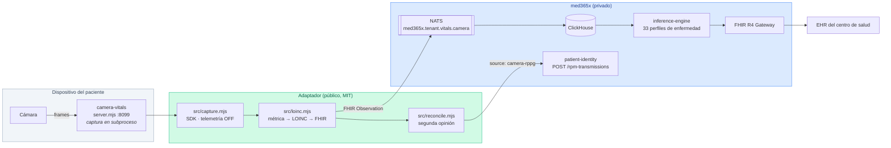
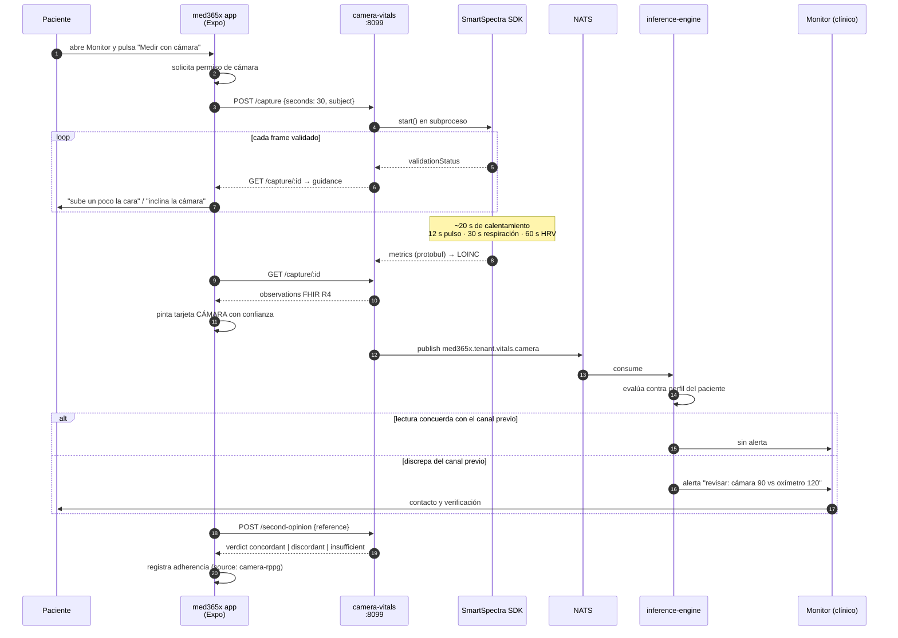

# Integración con med365x — control del paciente crónico

La cámara no reemplaza los dispositivos del paciente crónico: añade un canal
que no depende de hardware y permite **corroborar** lo que el paciente reporta.
Un hipertenso que olvidó el tensiómetro sigue transmitiendo pulso, respiración y
HRV; y una lectura que contradice la del oxímetro deja de ser un dato suelto y
pasa a ser una señal para revisar.

## Fase 1 — como servicio independiente

El adaptador corre donde está la cámara y expone HTTP. No necesita tocar el
backend de med365x para aportar valor: emite observaciones LOINC por NATS y
registra la adherencia por REST.

**Qué resuelve ya en esta fase**

| | |
|---|---|
| Vitales en el pipeline | las observaciones entran por el mismo subject que BLE y HealthKit |
| Adherencia RPM | `source: "camera-rppg"` cuenta para `transmission-days` |
| Corroboración | segunda opinión contra cualquier canal previo |
| Cero cambios en el motor | no se toca el scoring ni los 33 perfiles |

## Fase 2 — integrado en la app móvil

La app (Expo 58, `expo-camera` y `nats.ws` ya instalados) llama al servicio desde
la pantalla de Monitoreo. La captura sigue fuera del proceso de la app porque el
SDK necesita su propio ciclo de vida.

## Por qué importa en el paciente crónico

Un hipertenso o un diabético en seguimiento remoto se mide con dispositivos que
dependen de él: cargar el tensiómetro, emparejar el oxímetro, recordar la
báscula. Los huecos de datos se leen como falta de adherencia cuando muchas
veces son fallos de hardware o de memoria.

Tres efectos concretos:

**Continuidad sin hardware.** Pulso y respiración se obtienen con lo que el
paciente ya tiene. El canal no desaparece porque el dispositivo esté descargado.

**Detección de deriva.** El HRV y la respiración capturan estrés autonómico y
patrón respiratorio, señales que un tensómetro no ve. En un crónico, la tendencia
importa más que el valor aislado.

**Datos que se pueden contrastar.** Si el paciente reporta 118/76 y la cámara da
un pulso de 96 en reposo, eso es una discrepancia que merece una llamada. Antes
era un dato sin contexto.

## Límites que no se deben cruzar

- **No sustituye** un dispositivo validado. Es un canal adicional.
- **No diagnostica.** Bienestar informativo, sin aprobación regulatoria.
- **Las tolerancias de la segunda opinión son heurísticas**, no límites
  clínicos validados. Cada despliegue debe calibrarlas contra su referencia.
- **El encuadre es obligatorio**: cara centrada y pecho superior visible. Por eso
  la guía en vivo es parte del producto y no un mensaje de error.
