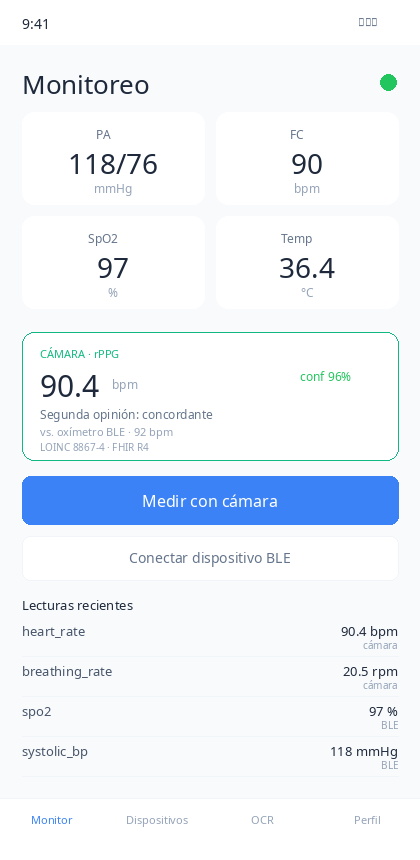
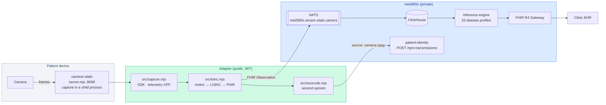
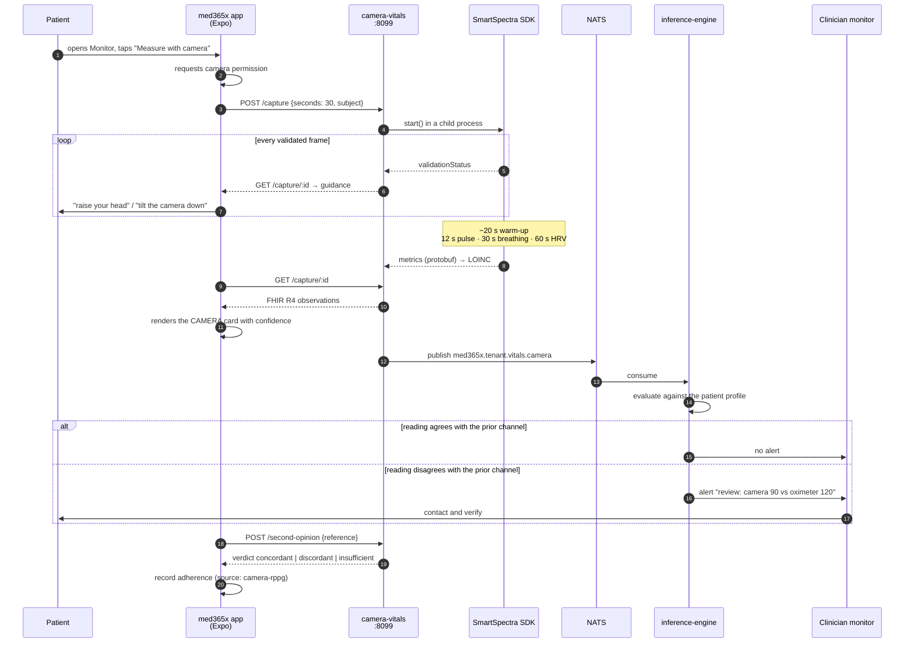

# med365x integration — continuous control of the chronic patient

Platform: **[med365x.com](https://med365x.com)** — remote patient monitoring with
FHIR R4 / HL7 interoperability and 33 disease profiles.

  
   
  The existing Monitor screen (PA / FC / SpO2 / Temp, BLE history) with the
  camera card added: value, confidence, and the second-opinion verdict against
  the BLE oximeter.

The camera does not replace the chronic patient's devices: it adds a channel that
does not depend on hardware, and it lets the platform **corroborate** what the
patient reports. A hypertensive patient who forgot the cuff keeps transmitting
pulse, breathing and HRV; and a reading that contradicts the oximeter stops being
an isolated number and becomes a signal worth reviewing.

## Phase 1 — standalone service

The adapter runs where the camera is and exposes HTTP. It needs no change in the
med365x backend to deliver value: it emits LOINC observations over NATS and
records adherence over REST.

### What this phase already delivers

| | |
|---|---|
| Vitals in the pipeline | observations enter through the same subject as BLE and HealthKit |
| RPM adherence | `source: "camera-rppg"` counts toward `transmission-days` |
| Corroboration | second opinion against any prior channel |
| No engine changes | the scoring logic and the 33 profiles are untouched |

## Phase 2 — integrated into the mobile app

The app (Expo 58, with `expo-camera` and `nats.ws` already installed) calls the
service from the Monitor screen. Capture stays outside the app process because the
SDK needs its own lifecycle, and a stuck session must not lock the UI.

## Why it matters for the chronic patient

A hypertensive or diabetic patient under remote follow-up is measured by devices
that depend on them: charging the cuff, pairing the oximeter, remembering the
scale. The resulting gaps read as non-adherence when they are often dead
batteries or forgotten hardware.

Three concrete effects:

**Continuity without hardware.** Pulse and breathing come from what the patient
already owns, so the channel does not disappear because a device is discharged.

**Drift detection.** HRV and respiratory pattern capture autonomic stress and
breathing rhythm — signals a cuff never sees. For a chronic patient the trend
matters more than any single value.

**Readings that can be contradicted.** If the patient reports a normal blood
pressure but the camera shows a resting pulse of 96, that is a discrepancy worth
a phone call. Before, it was a number with no context.

## Limits not to cross

- **It does not replace** a validated device. It is an additional channel.
- **It does not diagnose.** General wellness, no regulatory clearance.
- **The second-opinion tolerances are heuristics**, not validated clinical
  limits. Every deployment must calibrate them against its own reference.
- **Framing is mandatory**: face centred and upper chest visible. That is why the
  live guide is part of the product and not an error message.
